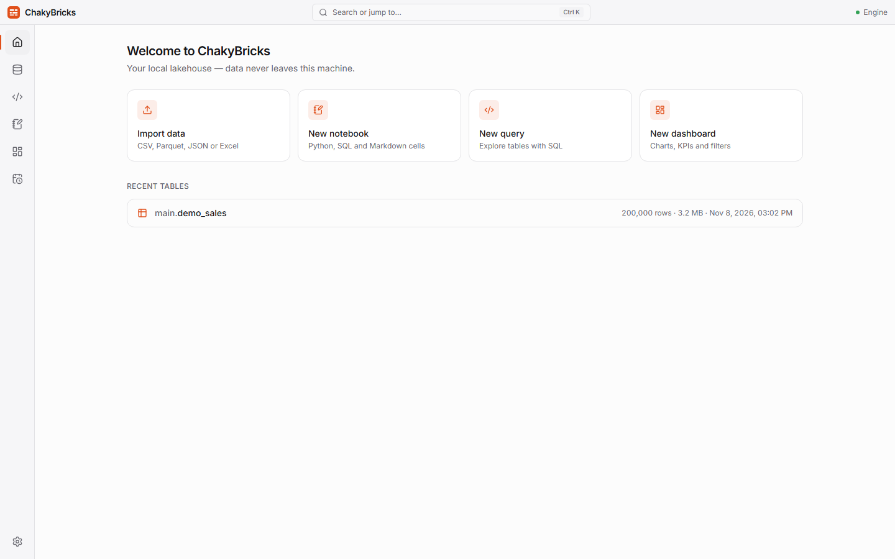
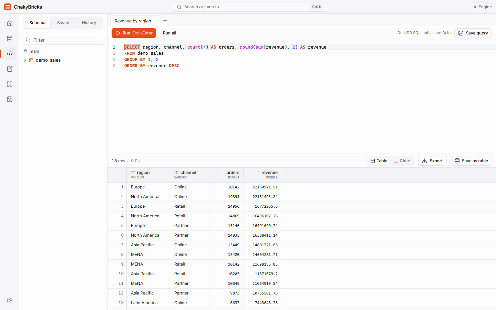
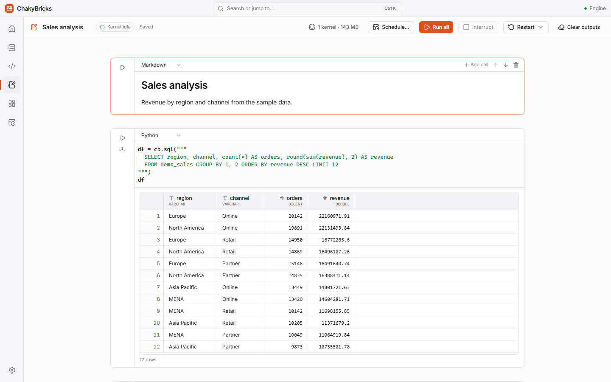
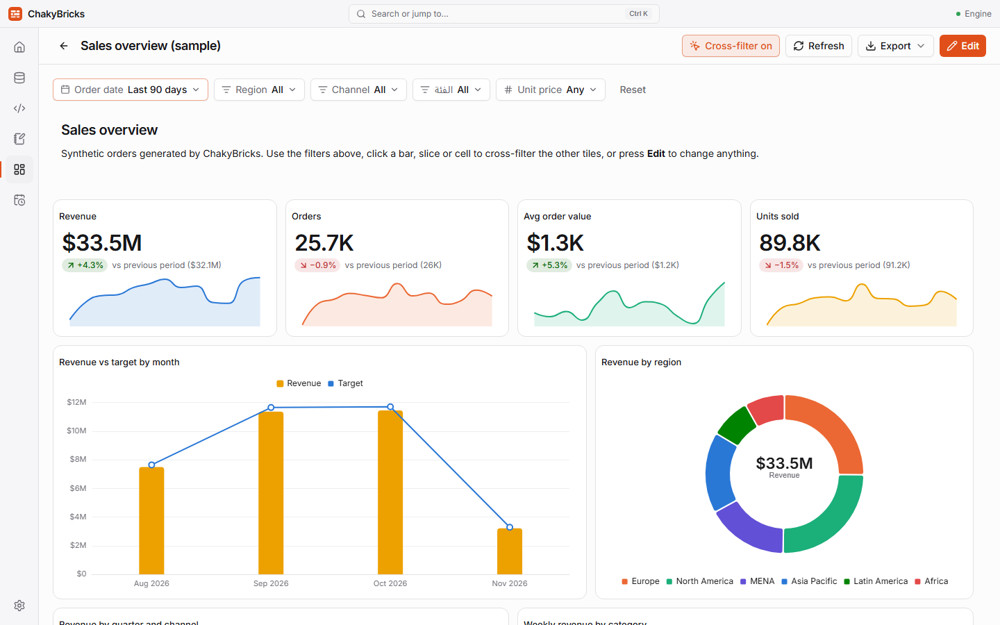

# ChakyBricks

An offline desktop lakehouse for Windows. Import data (up to ~10 GB), explore it with **SQL**, work with it in **Python notebooks**, build **dashboards**, and **schedule jobs** — all on your own machine, with no server, account or internet connection needed.



Website and documentation: **<https://chakybricks.pages.dev/>**

## What you get

- **Catalog** — import CSV, Parquet, JSON and Excel files into Delta tables with a streaming wizard (type overrides, partitioning, live preview). Arabic and other non-Latin column names work.
- **SQL editor** — DuckDB with autocomplete for tables and columns, a virtualized result grid, charts, column statistics, saved queries, history and export to CSV/Parquet. Writes (`CREATE TABLE … AS SELECT`, `INSERT INTO … SELECT`, `DROP`, `ALTER … RENAME`) are stored as Delta tables.
- **Notebooks** — Jupyter-compatible `.ipynb` files with Python, SQL and Markdown cells, Polars/pandas/Plotly/matplotlib, `%pip install`, and the `cb` helper (`cb.sql`, `cb.table`, `cb.save`).
- **Dashboards** — a no-code tile builder (charts, KPIs, tables, text), filters, cross-filtering, themes and PNG/PDF export.
- **Jobs** — run a notebook or a saved query on a schedule (interval, daily, weekly, monthly or cron) with run history and logs.

| SQL editor                              | Notebook                                   |
| --------------------------------------- | ------------------------------------------ |
|  |  |



## Install

1. [Download the installer](https://github.com/chaker88/ChakyBricks/releases/latest/download/ChakyBricks_x64-setup.exe), or pick a version from the [releases page](https://github.com/chaker88/ChakyBricks/releases).
2. Run it. The installer is not code-signed yet, so Windows SmartScreen may ask for confirmation: choose **More info → Run anyway**.
3. Start **ChakyBricks** from the Start menu.

Requirements: Windows 10/11 (64-bit) with WebView2 (included in current Windows), about 1 GB of disk space for the app plus room for your data, and 8 GB of RAM or more for large datasets.

## Quick start

1. **Import data.** On **Home** choose **Import data** (or press `Ctrl+K` and type _import_), pick a file, check the preview and column types, and start the import. Big files stream in without loading into memory.
2. **Query it.** Open **SQL** (`Ctrl+3`), write `SELECT region, sum(amount) FROM sales GROUP BY 1` and press `Ctrl+Enter`. Save useful queries from the toolbar.
3. **Use Python.** Open **Notebooks**, create a notebook and run:

   ```python
   df = cb.sql("SELECT * FROM sales LIMIT 1000")   # a Polars DataFrame
   cb.save(df.filter(df["amount"] > 100), "big_sales")
   ```

   A cell starting with `%%sql` runs SQL; `%pip install <package>` installs into your workspace environment.

4. **Build a dashboard.** Open **Dashboards → New dashboard**, add tiles, pick a table, a dimension and a metric. Add filters in the filter bar and click chart elements to cross-filter. Open **Dashboards → Sample dashboard** for a ready-made example.
5. **Schedule it.** Use **Schedule…** in a notebook or on a saved query to run it daily, hourly or on a cron schedule. See run history on the **Jobs** page.

### Jobs only run while ChakyBricks is running

There is no background service. To keep scheduled jobs running after you close the window, turn on **Settings → Background → Keep running in the background**: ChakyBricks stays in the system tray (menu: Open, Pause all jobs, Quit). **Start with the system** launches it minimized to the tray at sign-in. Both are off by default. Runs that were due while the app was not running are skipped, not made up later.

### Where is my data?

By default in `%APPDATA%\ChakyBricks` — change the **workspace folder** in Settings:

| Path                  | Contents                                              |
| --------------------- | ----------------------------------------------------- |
| `warehouse/<schema>/` | Delta tables (open standard; readable by other tools) |
| `notebooks/`          | `.ipynb` files                                        |
| `meta.db`             | catalog, saved queries, dashboards, jobs              |
| `tmp/`                | query spill files                                     |
| `.venv/`              | the notebook Python environment                       |

### Keyboard shortcuts

`Ctrl+K` command palette · `Ctrl+1…7` jump to Home, Catalog, SQL, Notebooks, Dashboards, Jobs, Settings · `Ctrl+Enter` run (SQL / cell) · `Shift+Enter` run cell and advance. The full list is in **Settings → Keyboard shortcuts**.

## Large data

ChakyBricks is tested with a 10 GB, 88-million-row CSV on a 16 GB machine: the import streams to Delta in about a minute, and queries and dashboards run with DuckDB's memory limit (60% of RAM by default, configurable in Settings) and spill to the workspace's `tmp/` folder instead of running out of memory. See [docs/load-test.md](docs/load-test.md) for the numbers and how to reproduce them with `scripts/make_test_data.py` and `scripts/load_test.py`.

## Development

Requirements: Windows 10/11 with WebView2, Python 3.12 (`py -3.12`), Node.js 20+, Rust (MSVC toolchain) and the Visual Studio C++ Build Tools.

```powershell
scripts\setup.ps1   # backend venv + npm install
scripts\dev.ps1     # launch the app (Tauri dev, backend from source)
scripts\check.ps1   # tests, type-checks, linters
npm run build:app   # bundled Python runtime + NSIS installer (about 20 minutes)
```

Releases are built by GitHub Actions when a `v*` tag is pushed (`.github/workflows/release.yml`). [SPEC.md](SPEC.md) describes the design; [CLAUDE.md](CLAUDE.md) holds the architecture notes.

```
src/          React frontend
src-tauri/    Tauri shell (spawns the backend, tray icon, autostart)
backend/      FastAPI backend (chakybricks package) + tests
scripts/      Dev, build and load-test scripts
docs/         Screenshots and the load-test report
```

## Created by

ChakyBricks is created by **Chaker Saidi**.

- GitHub: <https://github.com/chaker88>
- LinkedIn: <https://linkedin.com/in/chaker-saidi>

## License

Licensed under the [Apache License 2.0](LICENSE). See [NOTICE](NOTICE) for attribution and
[THIRD_PARTY_NOTICES.txt](THIRD_PARTY_NOTICES.txt) for the open-source software ChakyBricks bundles
(regenerate it with `backend\.venv\Scripts\python scripts\generate_notices.py` after changing
dependencies; the check fails if any component has no license text).
