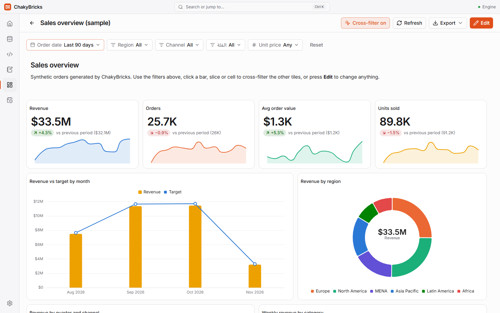

# Dashboards

Dashboards are grids of tiles — charts, KPI scorecards, tables and text — that you build without writing code. Open the list with ++ctrl+5++.

## Create a dashboard

- **New dashboard** creates an empty one: give it a name and start adding tiles.
- **Sample dashboard** generates a 200,000-row sales table (`main.demo_sales`, including an Arabic category column) and a dashboard called *Sales overview (sample)* with 12 tiles. It is the quickest way to see everything described below.

In the list, each dashboard has **Rename…**, **Duplicate** and **Delete** in its menu.

## View mode and edit mode

A dashboard opens in **view mode**: use the filters, click chart elements to cross-filter, **Refresh** the data, expand a tile to full size, and **Export**. Click **Edit** to change it.

In **edit mode** you can:

- **Add tile** and choose **Chart**, **KPI scorecard**, **Table** or **Text**.
- Drag a tile by its header and resize it from its edges or corner.
- Select a tile to open the **tile builder** in the right panel; duplicate or delete the tile with the buttons on the tile (the ++delete++ key also deletes the selected tile, ++esc++ deselects).
- Open **Filters** to manage the dashboard's filters, and **Style** to change the look.
- **Save** (++ctrl+s++) or discard your changes. Leaving with unsaved changes asks first.

## Tiles and the tile builder

Every chart, KPI and table tile reads from a **data source**: a table, or a [saved query](sql-editor.md#saved-queries) that is a single `SELECT`. The builder then offers:

**Charts** — choose the type: bar, stacked bar, line, area, combo (bars plus lines), pie, donut, scatter or heatmap.

- **Dimension** — what to group by. For date columns pick a grain: day, week, month, quarter or year.
- **Breakdown** — an optional second grouping that splits bars or lines into series (a heatmap uses it for its second axis). A breakdown works with one metric on bar, stacked bar, line, area and heatmap charts, with up to 8 series (20 on a heatmap); the rest are left out.
- **Metrics** — one or more, each with an aggregation (sum, average, count, count distinct, min, max), a label, and a number format (automatic, number, compact such as `1.2K` or `3.4M`, percent or currency). In a combo chart each metric can be drawn as bars or a line, and optionally on a right-hand axis with its own format. Pie, donut and heatmap charts take exactly one metric; a scatter chart takes two (X and Y).
- **Sort and limit** — order by the dimension or a metric and cap the number of items.
- **Display** — for example data labels.
- **Series colours** — colours are assigned from the value itself, so the same region has the same colour in every tile; you can override colours per tile.

**KPI scorecard** — one big number with an optional **comparison** to the previous period or the previous year (based on the active date filter) and an optional **trend line** over a date column.

**Table** — choose the columns to show, with optional metrics, sorting and a limit. A table tile shows up to the first 1,000 rows.

**Text** — Markdown for titles, notes and explanations.

## Filters

**Filters** are controls shown above the tiles. The types are:

- **Date range** — presets such as Today, Last 7/30/90/365 days, This/Last month, This quarter, This/Last year and All time, or a custom range.
- **Select** — pick values from a column, single or multiple, with a search box.
- **Number range** — minimum and maximum of a numeric column.

Each filter is tied to a column in a data source and applies to every tile whose source has that column. You can set the current value as the filter's default ("Use current value as default"), and **Reset** in the filter bar restores the defaults. Filter values are passed to the database as parameters, never pasted into SQL text.

## Cross-filtering

Click a bar, slice or heatmap cell to filter the other tiles by it; a chip appears above the dashboard, and clicking the same element again, or the chip's ✕, clears it. ++ctrl+click++ or ++shift+click++ adds to the selection. The **Cross-filter on/off** toggle in the header switches the feature off: in view mode that is a temporary switch, in edit mode it is saved with the dashboard.

## Style and refresh

**Style** sets the dashboard's colour **palette** (Classic, Sunset, Lagoon or Twilight), its **background** (Default, Soft or Contrast) and an **auto-refresh** interval (off, or every 10 or 30 seconds, 1, 5 or 15 minutes). Light and dark themes are both supported.

## Export

**Export** saves the dashboard as a **PNG image** or a **PDF document** through a save dialog. Text in any language, including Arabic, and the charts are included.

## Speed

Results are cached per query, filters and table version, so reopening a dashboard or switching a filter back is instant. By default tile queries run one at a time, which keeps memory use low on very large tables — on an 88-million-row table, a 10-tile dashboard loads in about 21 seconds the first time and in about a tenth of a second after that. You can change the number of simultaneous queries in [Settings](settings.md).
