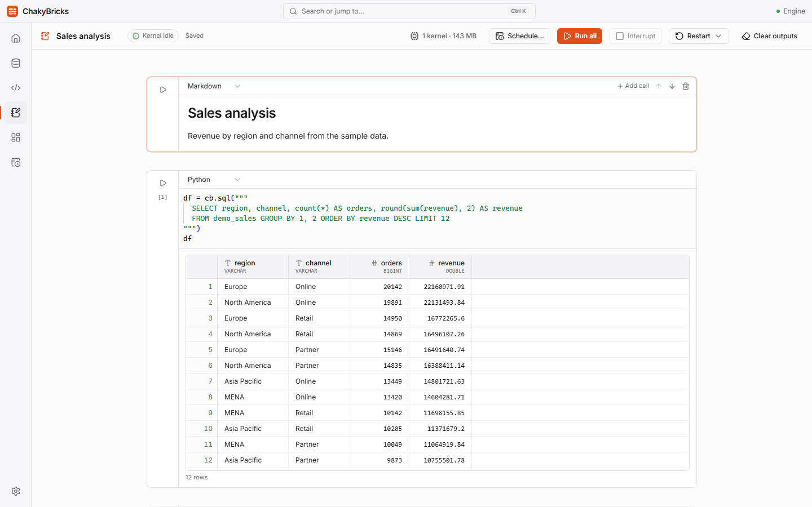

# Python notebooks

Notebooks combine Python, SQL and Markdown cells in one document. They are standard Jupyter `.ipynb` files stored in the `notebooks` folder of your workspace, so you can open them in other tools too. Open the list with ++ctrl+4++.



## The notebook list

**Notebooks** lists your notebooks, with options to create, **Rename…** (renames the `.ipynb` file; jobs that use it follow along) and **Delete…**. On a table's page in the Catalog, **Open in notebook** creates a notebook with starter cells for that table.

## Working in a notebook

- **Cells** are Python, SQL or Markdown; switch a cell's type with the menu at its top left. Hover between cells, or use the buttons at the bottom, to add **+ Code**, **+ SQL** or **+ Markdown**; each cell's toolbar can add a cell above or below, move it up or down, and delete it.
- **Run** a cell with ++shift+enter++ (run and move to the next cell), ++ctrl+enter++ (run and stay) or ++alt+enter++ (run and insert a new cell below), or with the play button.
- The toolbar has **Run all**, **Interrupt**, **Restart** (restart the kernel, restart and clear outputs, or restart and run all), **Clear outputs** and **Schedule…** (see [Jobs](jobs.md)).
- Each cell shows its execution counter and how long it took. Queued cells run in order; as in Jupyter, an error stops the rest of the queue.
- Notebooks **save automatically** a moment after you stop typing.
- The kernel starts when you open a notebook; a badge shows its state. The first notebook in a workspace takes a few seconds longer while the workspace's Python environment is created. A small indicator in the toolbar shows how many kernels are running and their memory; **Settings** lists them and lets you shut them down.

## Outputs

- **Tables.** DataFrames (Polars, pandas) and Arrow tables are shown in the same grid as the SQL editor: the first 1,000 rows plus the total row count.
- **Charts.** matplotlib figures show inline; Plotly figures are interactive.
- **Text, errors and more.** `print` output streams as it happens, tracebacks are formatted, and images, HTML, SVG and Markdown outputs render.

## SQL cells

A cell of type **SQL** (or any cell that starts with `%%sql`) runs SQL against your tables and shows the result as a table:

```sql
%%sql sales_by_region
SELECT region, sum(amount) AS total
FROM sales
GROUP BY region
```

The optional name after `%%sql` stores the result in a Python variable (here `sales_by_region`, a Polars DataFrame) for later cells. SQL cells run the same statements as the [SQL editor](sql-editor.md), including `CREATE TABLE … AS SELECT` and the other writes. In a SQL cell, errors are short and show only the SQL message.

## cb reference

`cb` is preloaded in every notebook; there is nothing to import. It works on the same tables as the SQL editor.

### `cb.sql(query)`

Runs SQL over your catalog tables and returns the result of the **last** statement as a **Polars DataFrame**. Use `.to_pandas()` on it for pandas.

```python
df = cb.sql("SELECT region, count(*) AS n FROM sales GROUP BY region")
pdf = df.to_pandas()
```

It accepts several statements separated by semicolons and the same writes as the SQL editor (`CREATE [OR REPLACE] TABLE … AS SELECT`, `INSERT INTO … SELECT|VALUES`, `DROP TABLE`, `ALTER TABLE … RENAME TO`). A write prints its message and, if it was the last statement, `cb.sql` returns `None`.

### `cb.table(name, version=None)`

Returns a **lazy Polars frame** (`LazyFrame`) over a table. Nothing is loaded until you `.collect()`, and Polars pushes filters and column selections down to the data, so this is the way to work with tables that are bigger than memory.

```python
lazy = cb.table("main.sales")
top = lazy.filter(pl.col("amount") > 100).group_by("region").agg(pl.col("amount").sum()).collect()

old = cb.table("sales", version=3)   # time travel: the table as of Delta version 3
```

`name` is `schema.table`, or just `table` for the `main` schema. Versions are listed on the table's **History** tab.

### `cb.save(df, name, mode="overwrite", partition_by=None)`

Writes a DataFrame to a Delta table and registers it in the catalog, so it shows up in the Catalog, the SQL editor and dashboards straight away.

- `df`: a Polars DataFrame or LazyFrame, a pandas DataFrame or Series, or an Arrow table.
- `name`: `schema.table`, or just `table` for `main`. The schema is created if it does not exist.
- `mode`: `"overwrite"` (default) replaces the table; `"append"` adds rows, and creates the table if it does not exist yet.
- `partition_by`: optional column to partition a **new or replaced** table by (ignored when appending to an existing table).

Column names are cleaned so they work unquoted in SQL and Python (the same rules as imports); when a name changes, `cb.save` prints a note. It returns a dictionary with the `table`, `rows`, `version` and `columns` of the result.

```python
cb.save(df.filter(df["amount"] > 100), "big_sales")
cb.save(new_rows, "sales", mode="append")
```

### `cb.tables()`

The catalog as a Polars DataFrame, one row per table, with the columns `schema`, `table`, `rows`, `size_bytes`, `version` and `updated_at`.

## Packages, memory and the environment

- Included packages are listed under [Settings and Python packages](settings.md#python-packages). Install more with `%pip install name`; `!` shell commands run in the same environment.
- Each notebook's query engine may use 50% of the memory limit by default (configurable under **Notebook kernel memory**). Polars and pandas use ordinary process memory in addition, so for very large tables prefer `cb.sql` aggregations and `cb.table` lazy frames over loading everything with `.to_pandas()`.
- Kernels stop when you close ChakyBricks. Notebook **jobs** run in their own private kernel and never touch the notebook file; see [Jobs](jobs.md).
