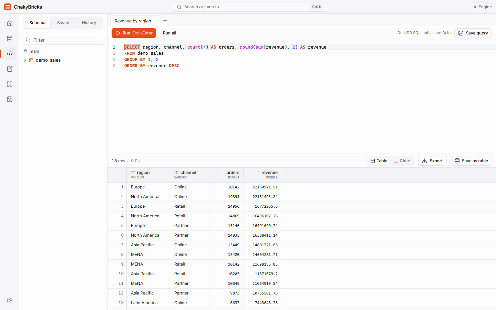

# SQL editor

The SQL page runs **DuckDB** SQL directly on your tables. Open it with ++ctrl+3++.

## Writing and running queries

- Write a query and press ++ctrl+enter++ (or click **Run**). If you select some text first, only the selection runs.
- **Run all** (++ctrl+shift+enter++) runs every statement in the editor, one after another. The result of the **last** statement is shown. Tables created earlier in the same run are visible to later statements.
- **Cancel** appears while a query is running and stops it.
- Autocomplete suggests tables, columns and SQL keywords as you type; press ++ctrl+space++ to open the suggestions.
- Tables in the `main` schema can be written without a prefix (`FROM sales`); other schemas use `schema.table`.
- Open several queries in **tabs** with **+**. Your tabs and their text are restored when you reopen the app.

The sidebar has three tabs: **Schema** (tables and columns), **Saved** (your saved queries) and **History** (recent runs with status, duration and row count; the last 500 are kept, and **Clear history** empties them).

## Results

The result grid is virtualized, so it stays fast with many rows. Columns can be resized.

- **Rows shown and total.** The grid loads the first rows of the result (10,000 by default; change it in [Settings](settings.md)) and always shows the exact total row count. Exports are not limited by that number.
- **Column statistics.** Click a column header to see statistics over the **full** result: rows, nulls, approximate distinct count and, for numbers, min, max, mean, standard deviation and quartiles.
- **Table / Chart.** Switch to **Chart** for a quick bar, line, pie or scatter chart of the rows loaded in the grid. For polished charts use [dashboards](dashboards.md).
- **Export.** **Export** writes the full result to **CSV** or **Parquet** through a save dialog. The file is written by streaming, so very large results are fine.
- **Save as table.** Stores the result as a Delta table: **Create table**, **Append rows** or **Replace table**, depending on whether the table already exists.

## Saved queries

Click **Save query** (or press ++ctrl+s++ in the editor) to give the query a name. Saved queries appear in the **Saved** sidebar tab, where the ⋯ menu lets you rename, schedule or delete them. They can be used as the data source of dashboard tiles and can be [scheduled as jobs](jobs.md). Names are unique, ignoring upper and lower case. Renaming a query keeps the dashboards that use it working.

## Writing data

Besides `SELECT`, the editor runs these statements, which write Delta tables:

| Statement | Notes |
| --- | --- |
| `CREATE [OR REPLACE] TABLE [IF NOT EXISTS] t AS SELECT …` | Creates or replaces a table from a query. Column names are cleaned like in imports. |
| `INSERT INTO t SELECT …` or `INSERT INTO t VALUES …` | Appends rows. Columns are matched **by position** and converted to the table's types; a column list is not supported. |
| `DROP TABLE [IF EXISTS] t` | Deletes a table and its history. |
| `ALTER TABLE [IF EXISTS] t RENAME TO u` | Renames a table. |

`EXPLAIN`, `DESCRIBE` and `SUMMARIZE` also work. Everything else — `UPDATE`, `DELETE`, `TRUNCATE`, `COPY`, `ATTACH`, `SET`, `PRAGMA`, views, schemas, temporary tables and plain `CREATE TABLE` — is rejected with a message that lists what is supported. To change rows, write a new table with `CREATE OR REPLACE TABLE … AS SELECT`.

A write shows a success message (rows written, table version) instead of a grid. The catalog updates automatically.

## Time travel

Time travel is not SQL syntax in DuckDB. Use the **History** tab on a table's page in the Catalog, or `cb.table("sales", version=3)` in a [notebook](notebooks.md#cb-reference).

## Large queries

Queries use up to the **memory limit** from Settings (60% of your RAM by default) and spill to the `tmp` folder in your workspace when they need more. A cap on that spill space keeps a runaway query from filling your drive: it fails with *"Not enough disk space for this query"* instead. See [Troubleshooting](troubleshooting.md).
