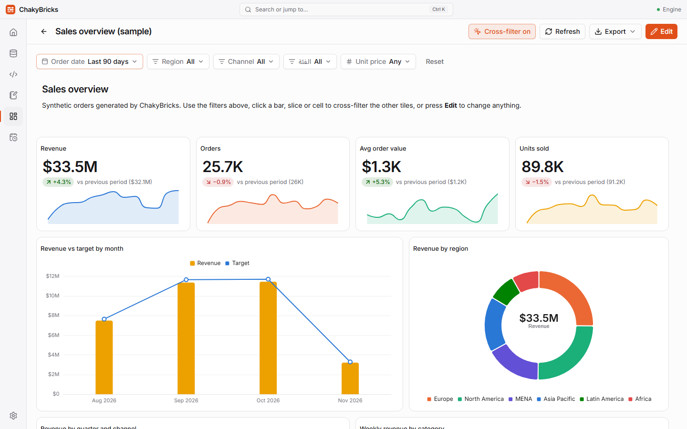
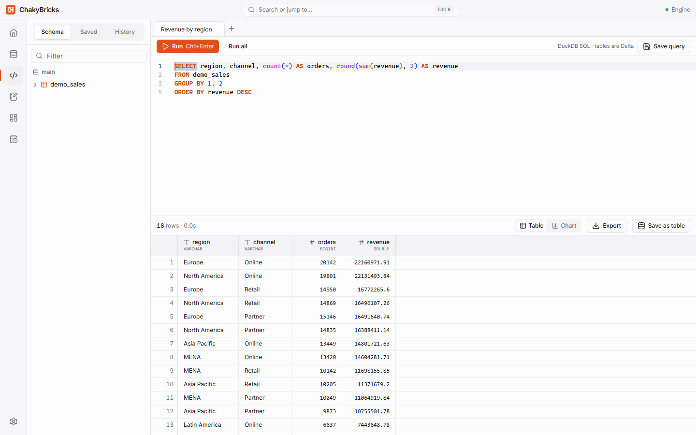
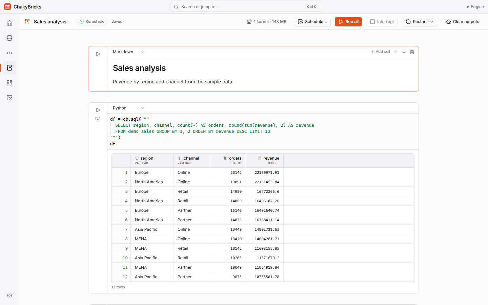

# Build · Analyze · Innovate Locally

ChakyBricks is an offline desktop lakehouse for Windows. Import data files of up to about 10 GB, explore them with **SQL**, work with them in **Python notebooks**, build **dashboards** and **schedule jobs** — all on your own machine, with no server, no account and no internet connection needed.

[:fontawesome-brands-windows: Download for Windows](https://github.com/chaker88/ChakyBricks/releases/latest/download/ChakyBricks_x64-setup.exe){ .md-button .md-button--primary .cb-download }

Version 1.0.0 · installer about 194 MB · Windows 10/11 (64-bit) · free and open source (Apache-2.0) · <a href="https://github.com/chaker88/ChakyBricks/releases">All releases</a>

!!! note "Windows protected your PC?"

    The installer is not code-signed yet, so Windows SmartScreen may show **"Windows protected your PC"** when you run it. Click **More info**, then **Run anyway**. This is expected for new, unsigned apps; the full source code is on [GitHub](https://github.com/chaker88/ChakyBricks).

## What you can do

- :material-database-import: **Import and catalog**

    A streaming wizard turns CSV, TSV, Parquet, JSON and Excel files into Delta tables, with editable column types, partitioning and a live preview. Arabic and other non-Latin column names work.

    [:octicons-arrow-right-24: Importing data](docs/importing-data.md)

- :material-database-search: **SQL editor**

    DuckDB with table and column autocomplete, a virtualized result grid, column statistics, charts, saved queries, history and export to CSV or Parquet.

    [:octicons-arrow-right-24: SQL editor](docs/sql-editor.md)

- :material-notebook-edit: **Python notebooks**

    Jupyter-compatible notebooks with Python, SQL and Markdown cells. Polars, pandas, Plotly and matplotlib included, `%pip install` for more, and the `cb` helper for your tables.

    [:octicons-arrow-right-24: Python notebooks](docs/notebooks.md)

- :material-view-dashboard: **Dashboards**

    A no-code tile builder with charts, KPI scorecards, tables and text, global filters, cross-filtering, palettes and export to PNG or PDF.

    [:octicons-arrow-right-24: Dashboards](docs/dashboards.md)

- :material-calendar-clock: **Jobs**

    Run a notebook or a saved query on a schedule — every few minutes, daily, weekly, monthly or with a cron expression — with run history and live logs.

    [:octicons-arrow-right-24: Jobs and background mode](docs/jobs.md)

- :material-shield-lock: **Private by design**

    Your data stays in a folder on your computer. Nothing needs an internet connection; only installing extra Python packages does.

    [:octicons-arrow-right-24: Settings](docs/settings.md)

## See it in action

## Fast on large data

Tested with a synthetic 88.5-million-row, 10.2 GB CSV on a 16 GB machine (15.4 GB RAM, DuckDB memory limit 9.2 GB):

<strong>61 s</strong>import 10.2 GB CSV → Delta

<strong>2.5 s</strong>GROUP BY over all 88.5 M rows

<strong>21 s</strong>first load of a 10-tile dashboard

<strong>0.1 s</strong>the same dashboard, second load

<strong>4.3 GB</strong>peak memory of that first load

No out-of-memory errors; queries that do not fit in memory spill to disk, with a cap that protects your drive. See the [full numbers and how to reproduce them](https://github.com/chaker88/ChakyBricks/blob/main/docs/load-test.md).

## Requirements

- Windows 10 or 11, 64-bit, with WebView2 (already part of current Windows 10/11).
- About 1 GB of disk space for the application, plus room for your data and for temporary query files.
- 8 GB of RAM or more is recommended for large datasets; 16 GB for files around 10 GB.
- Nothing else to install: ChakyBricks ships its own Python.

## Install in three steps

1. [Download the installer](https://github.com/chaker88/ChakyBricks/releases/latest/download/ChakyBricks_x64-setup.exe) and run it ([all releases](https://github.com/chaker88/ChakyBricks/releases)).
2. If Windows shows **"Windows protected your PC"**, click **More info → Run anyway**.
3. Start **ChakyBricks** from the Start menu and follow [Getting started](docs/getting-started.md).
